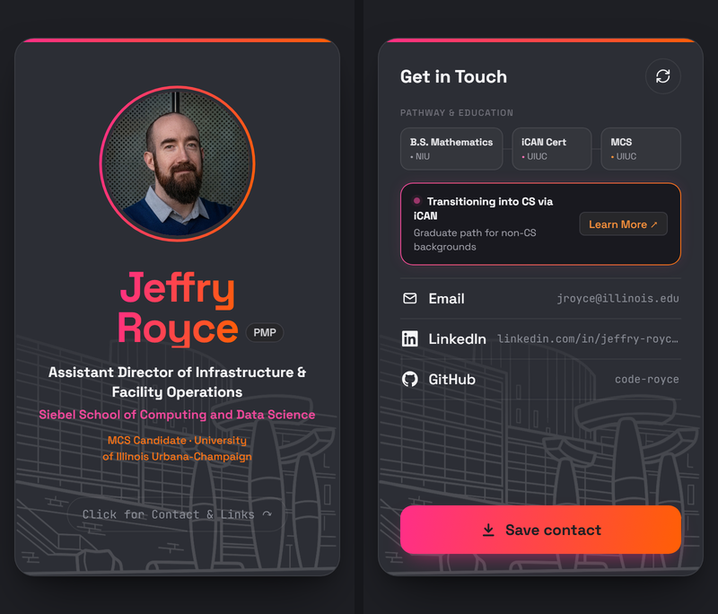

# Bio card

My digital business card, made to be pulled up on a phone. The front has my photo, name, title and school. Tap it and it flips over to my education path, a link to the iCAN program, my contact info, and a button that saves me to their contacts. A line drawing of Siebel Center is etched into the bottom of both sides.

**Live:** https://code-royce.github.io/mp0/



## What it does

- Flips between front and back on a tap, a click, or the keyboard (Esc flips it back). On desktop it tilts a little toward the mouse. If your system is set to reduce motion, the tilt is off and the card crossfades instead of flipping.
- **Save contact** downloads a vCard (`jeffry-royce.vcf`) with my name, title, email, links and photo, so a phone can add me in one step.

## Changing the details

Most of the card, and everything in the vCard, comes from [`src/contact.json`](src/contact.json). Edit it there and rebuild. A few display-only bits, like the iCAN banner and the link labels, are written straight into `src/index.html`. The LinkedIn and GitHub logos are in `src/assets/icons.svg`. The photo is `src/assets/siebel-photo.jpg`. The background is `src/assets/operations-etch.png`, a white-on-transparent copy of `operations.jpg`.

## Run it locally

You need [Node.js](https://nodejs.org/). The first time, run `npm install`. After that:

```
npm start        # dev server at http://localhost:8080, reloads as you edit
npm run build    # writes the site to build/
```

Pushing to `main` builds the site and deploys it to GitHub Pages through `.github/workflows/static.yml`.

## Background

This started as MP0 for CS 409 (The Art of Web Programming) at UIUC, fall 2026: a static bio card in HTML and CSS. The original assignment is in [SPEC.md](SPEC.md), and the graded version is tagged `v1.0-submitted`. The makeover borrows the look of my personal site.
